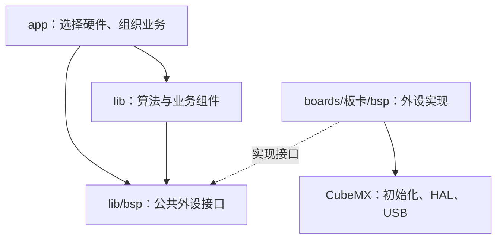
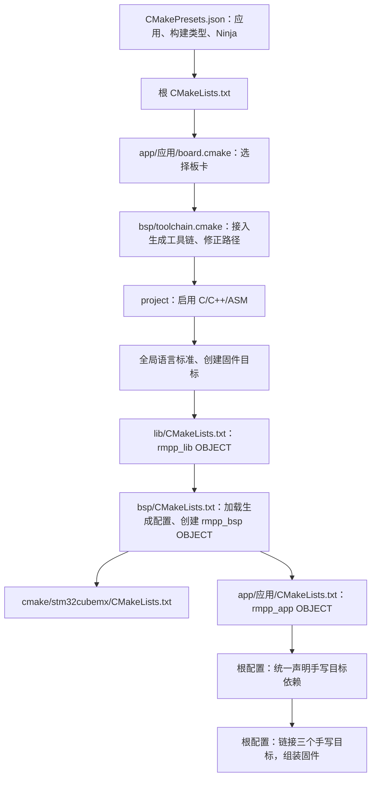

# 构建与验证

在 CLion 打开项目根目录，选择根 `CMakePresets.json` 中的应用预设，例如 `hero-debug`

```sh
cmake --preset hero-debug
cmake --build --preset hero-debug --clean-first --parallel 8
python tools/check_builds.py
```

未将构建工具加入 PATH 时，`check_builds.py` 可通过 `--cmake`、`--ninja` 指定 CLion 自带程序的路径；各预设日志保存在 `build/checks/`

## 接口与板卡实现



例如 `lib/bsp/can.hpp` 声明 `Can` 接口，板卡的 `bsp/can.cpp` 实现成员函数并调用 HAL。app 和公共组件使用接口；根构建选择板卡实现并把它加入固件。接口关系不等于 CMake 目标必须逐层链接的关系，也不需要建立 lib 与 BSP 的循环目标依赖

当前公共库中的 EKF 包含 `arm_math.h`，因此 `rmpp_lib` 仍需要本板 CMSIS-DSP 的编译接口

## CMake 文件如何协作



上图描述配置阶段的调用顺序；实际并行编译顺序由目标和文件依赖决定

| 文件 | 职责 |
| --- | --- |
| 根 `CMakeLists.txt` | 读取板卡选择，在 `project` 前指定工具链；统一语言标准；创建固件和模块目标；集中声明手写目标依赖；组装固件 |
| `lib/CMakeLists.txt` | 编译公共组件；公开 `lib` 包含路径；仅对自身源码屏蔽 packed 位域兼容性提示 |
| 板卡 `bsp/CMakeLists.txt` | 直接接入 CubeMX 内层配置；编译手写 BSP 和 FlashDB；配置 FlashDB 包含路径 |
| 应用 `CMakeLists.txt` | 收集选中应用的源码并创建对象库，依赖由根目录统一声明 |
| 板卡 `bsp/toolchain.cmake` | 包含生成的 GCC 工具链，紧接着修正链接脚本和 map 路径 |

板卡外层 `CMakeLists.txt` 不参与根工程构建，不再重复调用 `project` 或创建可执行目标。它与内层生成配置、生成工具链均保持原样；不把外层空配置段或当前无效的 `ob` 删除语句搬入手写配置

工具链中的链接脚本修正解决“生成工具链假设链接脚本位于根目录”的问题；map 路径固定到构建根目录，文件名使用 `${CMAKE_PROJECT_NAME}`。根目录创建的 ELF 默认也位于构建根目录，不再额外设置输出目录；CubeMX 已声明 map 的 clean 规则

## 目标与最终产物

| 目标 | 类型 | 内容 |
| --- | --- | --- |
| `${CMAKE_PROJECT_NAME}` | 可执行目标 | 最终 `.elf`；工程名只在根 `project(rmpp ...)` 定义 |
| `rmpp_lib` | `OBJECT` | 公共组件的对象文件，不再生成 `librmpp_lib.a` |
| `rmpp_bsp` | `OBJECT` | 板卡外设实现与 FlashDB |
| `rmpp_app` | `OBJECT` | 当前应用 |
| `stm32cubemx` | `INTERFACE` | 生成代码的包含路径和宏，本身不编译 HAL |
| `STM32_Drivers` | `OBJECT` | HAL 驱动 |
| `USB_Device_Library` | `OBJECT` | USB 协议栈 |

CubeMX 把 main、启动文件和外设初始化源码直接加入可执行目标，并接入 HAL、USB 与预编译 DSP 库。内层部分注释写着 static library，实际 `add_library` 使用的是 `OBJECT`

所有手写目标的链接依赖集中在根目录，等子目录创建全部目标后再声明。CubeMX 自身的依赖配置仍留在生成文件中，不改写：

```cmake
target_link_libraries(rmpp_app PRIVATE rmpp_lib)
target_link_libraries(rmpp_bsp PRIVATE rmpp_lib stm32cubemx)

# TODO: 解除公共库 EKF 对板卡 CMSIS-DSP 编译接口的依赖，届时删除此行
target_link_libraries(rmpp_lib PRIVATE stm32cubemx)
```

根配置显式加入 `rmpp_app`、`rmpp_bsp`、`rmpp_lib` 三组对象文件，不依赖对象文件跨多层目标自动传递。`rmpp_app` 不需要包含板卡实现目录；BSP 实现由最终固件组装。DSP `.a` 继续使用，但只由 CubeMX 接入一次，不再给公共库重复添加绝对路径依赖

`rmpp_lib → stm32cubemx` 是待解决的板卡耦合，当前为了 EKF 编译保留；移除相应源码依赖后再删除该链接声明。FlashDB 的 `<flashdb.h>`、`<fdb_cfg.h>` 等引用需要显式搜索路径，即使文件同目录也不能默认省略 `target_include_directories(rmpp_bsp PRIVATE flashdb)`

## plain 与 keyword 链接形式

```cmake
target_link_libraries(A B)         # plain
target_link_libraries(A PUBLIC B)  # keyword
```

在本项目的现代 CMake 策略下，这两种写法通常都会让 A 使用 B，并向 A 的下游传递 B。plain 不等于默认 PRIVATE。区别在于参数签名：keyword 可分别表达 PRIVATE、PUBLIC、INTERFACE；同一目标的全部 `target_link_libraries` 调用必须统一签名，放在不同目录也不能混用。历史旧策略还可能改变链接接口行为，本项目不使用旧策略

不强制全工程采用某一种签名，按目标的实际语义和已有调用选择。CubeMX 对最终固件使用 plain，根目录对同一目标也采用 plain：

```cmake
target_link_libraries(${CMAKE_PROJECT_NAME}
    rmpp_app
    rmpp_bsp
    rmpp_lib
)
```

直接链接对象库会加入其对象文件并继承公开使用要求，不需要 `set_property` 或 `$<TARGET_OBJECTS:...>`。其他手写目标目前使用 PRIVATE，表达各自的实现依赖；它们与固件是不同目标，因此不构成签名混用

## 语言标准、告警与生成器

根配置在创建任何目标前统一设置 C11、C++20，启用 `STANDARD_REQUIRED` 和 GNU 扩展。子目录继承这些默认值，不再重复给 `rmpp_lib` 设置 `target_compile_features`；目标仍可显式覆盖标准

`-Wno-packed-bitfield-compat` 通过 `target_compile_options(rmpp_lib PRIVATE ...)` 仅作用于公共库源码，不传给 app、BSP、HAL 或 USB。它屏蔽某些 packed 位域相对旧 GCC 的布局兼容性提示，不改变结构体布局，也不是 MAVLink 专用开关


`cmake --build` 调用选定的底层构建工具，本项目是 Ninja。普通 Ninja 每个构建目录对应一个构建类型；当前 presets 分别提供 Debug/Release 目录。Ninja Multi-Config、Visual Studio 等支持一个目录包含多种配置，本项目不需要切换

## 修改与重新生成后的检查

- 新应用沿用现有应用 CMake，使用 `board.cmake` 选择板卡，并更新根 presets
- 修改工程名只改根 `project`；固件和 map 名称使用工程名变量，三个手写目标名保持稳定
- CubeMX 重新生成后检查内层目标名称、链接签名、DSP 配置及工具链中的路径文本，确保两处路径适配仍匹配
- 通过真实构建检查 DSP 只链接一次、ELF/map 位于构建根目录、clean 清理 map，以及语言标准和告警选项的作用范围

## 编译接口

- `Can{}` 是可常量初始化的未绑定句柄，用于电机型号的 `constexpr DEFAULT_CONFIG`；实际通道仍由应用通过 `Can(1)`、`Can(2)` 选择，未绑定句柄的发送和回调注册返回失败
- MAVLink 发送缓冲使用协议的 `MAVLINK_MAX_PACKET_LEN`，覆盖最大载荷、帧头、校验和及签名，不依赖 UART 实现内部的缓冲区容量
- 应用显式向 MAVLink 传入 `Cdc(1)`，与 STM32F407 板卡唯一的 USB CDC 通道及接收回调一致

## 验证记录

2026-09-28 使用 CLion 2026.2.2 的 MCP 终端调用其自带 CMake、Ninja 和已配置的 Arm GNU 工具链：

- `hero-debug`、`hero-release` 清理后完整构建通过；验证 clean 同时删除各自根构建目录的 ELF 和 map
- `tools/check_builds.py` 的 24 个预设全部通过，覆盖英雄、步兵、哨兵及九个示例的 Debug/Release；结果见 `build/checks/passed.json`
- 检查全部预设的生成规则和编译命令：对象文件无重复，公共库不再生成 `.a`；DSP 仅链接一次；C/C++ 分别使用 GNU C11/C++20；位域告警屏蔽仅作用于 `rmpp_lib`。全部手写目标链接依赖已集中到根目录，子目录无重复声明
- `hero-debug` RAM 为 35,368 B，Flash 为 121,352 B；本轮未修改 C/C++，无需重新执行源码格式化
- Hero Debug 清理重建无编译告警；Hero Release 仍有 4 条来自现有代码的告警：`QuaternionEKF.c:459/461` 的类型别名及未初始化诊断，`ui_interface.c:202` 的数组越界诊断。此前移除统一的语言标准选项后也可复现，未在本轮修改或屏蔽这些代码
- 清理重建日志见 `build/hero-debug/mcp-clean-build.log`、`build/hero-release/mcp-clean-build.log`；配置检查与清理重建告警明细见 `build/checks/cmake-verification.json`

工程应用 `app/engineer` 尚无 CMake 入口和构建预设，未编译验证；未执行烧录或上车测试
