## 开发板 C 型

v1.0 用户手册

2020.01

## 快速搜索关键词

PDF 电子文档可以使用查找功能搜索关键词。例如在 Adobe Reader 中， Windows 用户使用快捷 键 Ctrl+F ， Mac 用户使用 Command+F 即可搜索关键词。

## 点击目录转跳

用户可以通过目录了解文档的内容结构，点击标题即可跳转到相应页面。

## 打印文档

本文档支持高质量打印。

## 目 录

|免责声明|2|
|---|---|
|产品使用注意事项|2|
|RoboMaster 开发板 C 型|2|
|简 介|2|
|物品清单|2|
|接口及线序说明|3|
|开发板|3|
|XT30 电源线线序|3|
|SWD 下载线线序|4|
|2-pin CAN 线|4|
|4-pin CAN 线|4|
|尺寸及安装说明|4|
|功能说明|5|
|电源框图|5|
|输入防护电路|6|
|用户自定义LED|6|
|5V 接口|7|
|BOOT 配置接口|7|
|micro USB 接口|8|
|SWD 接口|9|
|按 键|9|
|可配置I/O 接口|10|
|UART 接口|10|
|CAN 总线接口|11|
|PWM 接口|12|
|DBUS 接口|13|
|数字摄像头FPC 接口|14|
|蜂鸣器|14|
|电压检测|15|
|六轴惯性测量单元|15|
|磁力计|16|
|使  用|17|
|特征参数|17|
|附表|17|

## 免责声明

感谢您购买 RoboMasterTM 开发板 C 型（以下简称“开发板”）。在使用之前，请仔细阅读本声明， 一旦使用，即被视为对本声明全部内容的认可和接受。请严格遵守手册、产品说明和相关的法律法规、 政策、准则安装和使用该产品。在使用产品过程中，用户承诺对自己的行为及因此而产生的所有后果 负责。因用户不当使用、安装、改装造成的任何损失， DJITM 将不承担法律责任。

DJI 和 RoboMaster 是深圳市大疆 TM 创新科技有限公司及其关联公司的商标。本文出现的产品名称、 品牌等，均为其所属公司的商标。本产品及手册为大疆创新版权所有。未经许可，不得以任何形式复 制翻印。关于免责声明的最终解释权，归大疆创新所有。

本文档及本产品所有相关的文档最终解释权归大疆创新所有。如有更新，恕不另行通知。请访问 www. robomaster.com 官方网站以获取最新的产品信息。

## 产品使用注意事项

1. 请按照本说明正确使用线材，以免损坏线材或者开发板。

2. 使用前请检查线材有无老化、损坏。如存在以上现象，请更换新线材。

3. 请按照本说明在规定的工作环境（如电压、温度等参数）使用，否则可能会影响产品寿命或造成永 久性损坏。

4. 请使用正确的方式固定开发板，避免开发板受到物理损坏。

5. 开发板上电后如发现有火花、冒烟、焦糊味或其它异常，请立即关掉电源。

6. 使用时请不要掀开硅胶外壳，避免由于异物造成开发板短路或性能下降。

## RoboMaster 开发板 C 型

## 简 介

RoboMaster 开发板 C 型采用高性能的 STM32 主控芯片，支持宽电压输入，集成专用的扩展接口、通 信接口以及高精度 IMU 传感器，可配合 RoboMaster 产品或者其他配件使用。开发板具备防反接、防 过压等保护功能；结构紧凑，集成度高，配套例程丰富，可广泛应用在机器人比赛、科研教育、自动 化设备等领域。

## 物品清单

## 开发板 C 型 × 1

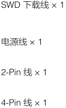

> 图中文字：
>
> SWD  下载线 × 1
> 电源线 × 1
> 2-Pin  线 × 1
> 4-Pin  线 × 1

## 接口及线序说明

## 开发板

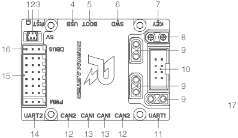

> 图中文字：
>
> 123 4 5 6 7
> 8
> 16 9
> 10
> 15
> 9
> 9
> 17
> 14 12 13 13 12 11

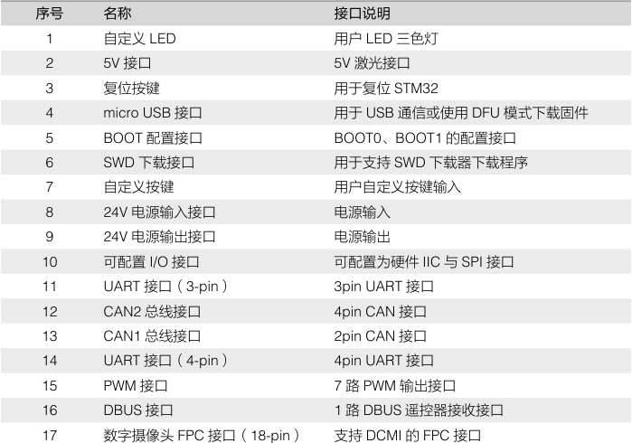

> 图中文字：
>
> 序号 名称 接口说明
> 1 自定义 LED 用户 LED  三色灯
> 2 5V  接口 5V  激光接口
> 3 复位按键 用于复位 STM32
> 4 micro USB  接口 用于 USB  通信或使用 DFU  模式下载固件
> 5 BOOT  配置接口 BOOT0 、 BOOT1  的配置接口
> 6 SWD  下载接口 用于支持 SWD  下载器下载程序
> 7 自定义按键 用户自定义按键输入
> 8 24V  电源输入接口 电源输入
> 9 24V  电源输出接口 电源输出
> 10 可配置 I/O  接口 可配置为硬件 IIC  与 SPI  接口
> 11 UART  接口（ 3-pin ） 3pin UART  接口
> 12 CAN2  总线接口 4pin CAN  接口
> 13 CAN1  总线接口 2pin CAN  接口
> 14 UART  接口（ 4-pin ） 4pin UART  接口
> 15 PWM  接口 7  路 PWM  输出接口
> 16 DBUS  接口 1  路 DBUS  遥控器接收接口
> 17 数字摄像头 FPC  接口（ 18-pin ） 支持 DCMI  的 FPC  接口

XT30 电源线线序

A B

线长 450mm ，线序从上到下依次为： A 红色（正极）， B 黑色（负极）

## SWD 下载线线序

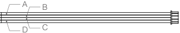

> 图中文字：
>
> A B
> D C

线长 100mm ，线序从上到下依次为：

A 黑色（ SWDIO ）， B 黑色（ SWCLK ）， C 黑色（ GND ）， D 黑色（ 3.3V ）

## 2-pin CAN 线

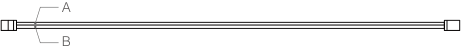

线长 350mm ，线序从上到下依次为： A 黑色（ CANL ）， B 红色（ CANH ）

## 4-pin CAN 线

A B D C

线长 350mm ，线序从上到下依次为：

A 灰色（ CANL ）， B 灰色（ CANH ）， C 灰色（ GND ）， D 红色（ 5V ）

## 尺寸及安装说明

## 请参考图示尺寸，正确安装开发板。

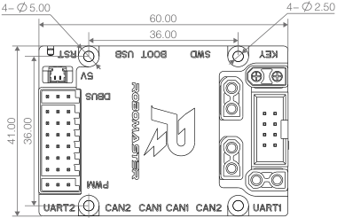

> 图中文字：
>
> 4− 5.00 4− 2.50
> 60.00
> 36.00

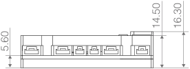

> 图中文字：
>
> 14.50 16.30
> 5.60

单位 : mm

开发板设有 4 个内径 2.5mm ，外径 5.0mm 的安装孔，方便用户安装开发板。此外，开发板可搭配 RoboMaster 电调中心板 2 实现接口扩展，如下图所示。

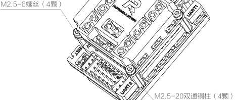

> 图中文字：
>
> M2.5-6螺丝（4颗）
> M2.5-20双通铜柱（4颗）

（备注：螺丝及铜柱需自行购买）

单位 : mm

## 功能说明

## 电源框图

开发板电源框图如下所示

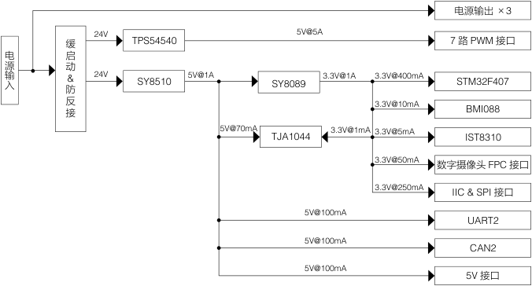

> 图中文字：
>
> 电源输出× 3
> 24V 5V@5A
> 缓 TPS54540 7  路 PWM  接口
> 启
> 动
> & 24V SY8510 5V@1A SY8089 3.3V@1A 3.3V@400mA STM32F407
> 防
> 反接 3.3V@10mA BMI088
> 5V@70mA TJA1044 3.3V@1mA 3.3V@5mA IST8310
> 3.3V@50mA 数字摄像头 FPC  接口
> 3.3V@250mA IIC & SPI  接口
> 5V@100mA
> UART2
> 5V@100mA
> CAN2
> 5V@100mA
> 5V  接口
> 电
> 源
> 输
> 入

## 开发板电源主要包括：

- 1 路： 24V 转 5V 降压电路（电源网络为 VCC_5V_M ），用于对外的 7 路 PWM 舵机接口，最大输出总 电流为 5A ；

- 1 路： 24V 转 5V 降压电路（电源网络为 VCC_5V ），用于板载器件的供电及作为下一级电源的输入， 最大输出电流为 1A ；

- 1 路： 5V （电源网络为 VCC_5V ）转 3.3V 的降压电路，主要用于板载器件的供电。

## 输入防护电路

电源输入接口采用 XT30 接口，具备输入防反接、缓启动保护；同时，开发板自带输入防过压保护电路， 当输入超过 28V 时，后级电路会关断，实现了过压保护作用。

## 用户自定义LED

开发板集成 1 颗共阳极 RGB LED 指示灯，对应的控制 IO 为 PH10 （蓝灯）、 PH11 （绿灯）、 PH12 （红 灯），当 IO 口输出高电平时，对应的 LED 指示灯点亮；当 IO 口输出低电平时，对应的 LED 指示灯 熄灭。用户也可以通过 PWM 控制对应指示灯的亮度。

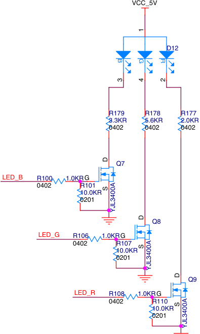

> 图中文字：
>
> VCC_5V
> D12
> R179 R178 R177
> 3.3KR 5.6KR 2.0KR
> 0402 0402 0402
> Q7
> LED_B R100 1.0KR G
> 0402 R101
> 10.0KR
> 0201
> Q8
> LED_G R106 1.0KR G
> 0402 R107
> 10.0KR
> 0201
> Q9
> LED_R R108 1.0KR G
> 0402 R110
> 10.0KR
> 0201
> 1
> B G R
> 3 4 2
> D
> S
> YJL3400A
> D
> S
> YJL3400A
> D
> S
> YJL3400A

## 5V 接口

开发板集成一个可控的 5V 电源接口，用户可以外接 RoboMaster 红点激光器， 对应的开关控制 IO 为 PC8 ，用户也可以通过 PWM 控制来实现对红外激光器的亮度调节。

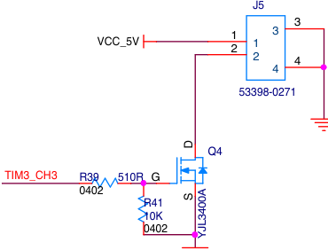

> 图中文字：
>
> J5
> 3
> VCC_5V 12 1 3
> 2 4
> 4
> 53398-0271
> Q4
> TIM3_CH3 R39 510R G
> 0402
> R41
> 10K
> 0402
> D
> S YJL3400A

## BOOT 配置接口

开发板上的 STM32 芯片有两个管脚 BOOT0 和 BOOT1 ，该管脚在芯片复位时的电平状态决定了芯片 复位后的启动方式。开发板的 BOOT 管脚配置原理图如下所示：

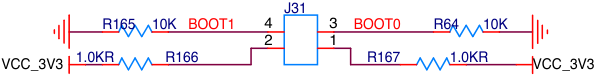

默认情况下 BOOT 管脚均为低电平， STM32 上电从 User Flash 启动。用户也可以通过跳线帽配置 BOOT0 与 BOOT1 的复位电平状态（ BOOT 配置引脚使用 2.54mm 间距的 2x2 排针引出，如下图所示）， 使得 STM32 以不同的方式启动。例如当 BOOT0 = 1 ， BOOT1 = 0 时， STM32 将从 System memory 启动，进入 DFU （ Device Firmware update ）模式（详见“ Micro USB 接口”）

> 图中文字：
>
> 4 3 1 2

STM32 启动方式与 BOOT 配置关系如下表所示：

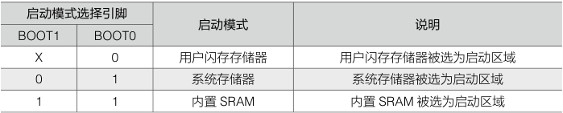

> 图中文字：
>
> 启动模式选择引脚
> 启动模式 说明
> BOOT1 BOOT0
> X 0 用户闪存存储器 用户闪存存储器被选为启动区域
> 0 1 系统存储器 系统存储器被选为启动区域
> 1 1 内置 SRAM 内置 SRAM  被选为启动区域

## micro USB 接口

开发板集成一个 USB 全速接口，可用于与其他设备进行 USB 通信。该接口符合 USB2.0 协议规范。 在主机模式下支持全速（ FS ， 12Mbps ）和低速（ LS ， 1.5Mbps ）收发器，而从机模式下仅支持全速（ FS ， 12Mbps ）收发器。

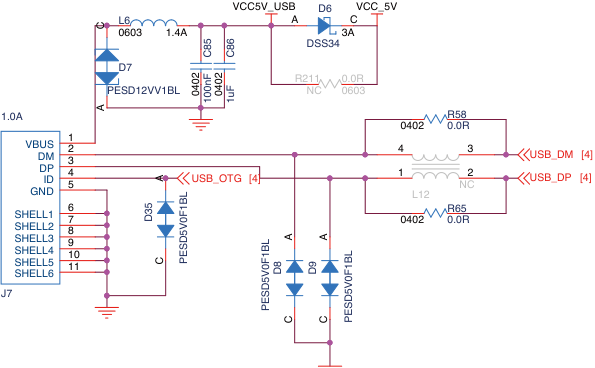

> 图中文字：
>
> VCC5V_USB D6 VCC_5V
> L6 A C
> 0603 1.4A 3A
> DSS34
> D7
> R211 0.0R
> PESD12VV1BL NC 0603
> 1.0A R58
> 0402 0.0R
> 1
> VBUSDM 32 4 3 USB_DM [4]
> DPID 45 USB_OTG [4] 1 NC2 USB_DP [4]
> GND L12
> 6 R65
> SHELL1 7 0402 0.0R
> SHELL2 8
> SHELL3 9
> SHELL4 10
> SHELL5 11
> SHELL6
> J7
> C
> C85 C86
> 4020 4020
> 100nF 1uF
> A
> A
> D35
> A A
> C PESD5V0F1BL D8 D9
> PESD5V0F1BL
> C C PESD5V0F1BL

用户可通过该 USB 接口实现对单板的供电（仅可以驱动 STM32 及部分板载外设 * ），也可以配合 BOOT 配置实现 DFU 模式下载固件。开发板使用 DFU 模式下载固件的操作步骤如下：

1. 通过跳线帽配置 STM32 的 BOOT0 电平状态为高电平，且 BOOT1 电平状态为低电平；

2. 将开发板通过 USB 线连接到 PC ；

3. 通过 RST 按键复位开发板，使开发板进入 DFU 模式；

4. 通过 DFU File Manager 软件将 BIN 文件转化成 DFU 文件；

5. 通过 DfuSe Demo 软件将第 4 步生成的 DFU 文件下载到开发板上。

*USB 供电只供给电源网络VCC_5V，不支持由电源网络 VCC_5V_M 供电的板载外设，例如PWM 外设接口。

## SWD 接口

开发板集成一个 SWD 调试接口，用于程序的下载和调试，接口线序如下所示。用户可通过专用仿真 器如 J-link 或 ST-link 下载与调试程序。

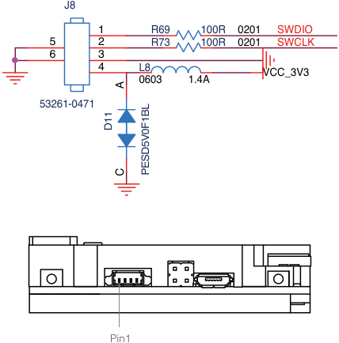

> 图中文字：
>
> J8
> 1 R69 100R 0201 SWDIO
> 5 2 R73 100R 0201 SWCLK
> 6 3
> 4 L8 V CC_3V3
> 0603 1.4A
> 53261-0471
> Pin1
> A
> D11
> C PESD5V0F1BL

## 按 键

开发板集成两个按键：复位按键（ RST ）和用户自定义按键（ KEY ）。用户自定义按键按下时 STM32 的 PA0 管脚电平状态为低电平。

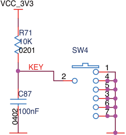

> 图中文字：
>
> VCC_3V3
> R71
> 10K
> 0201 SW4
> KEY 1
> 2 4
> 5
> C87 3
> 6
> 02100nF 7
> 04

## 可配置I/O 接口

为增强适用性，开发板集成了 1 个 2.54mm 间距的 8-pin 牛角座，用于用户连接 IIC 或 SPI 设备，该 接口支持 3.3V 或者 5V* 的通信设备。

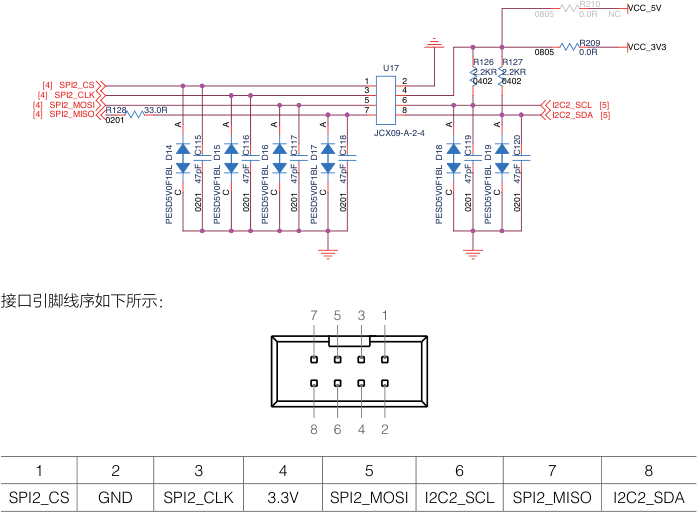

> 图中文字：
>
> 0805 0.0RR210 NC V CC_5V
> 0805 0.0RR209 V CC_3V3
> U17 2.2KRR126 2.2KRR127
> [4][4][4][4]SPI2_MOSISPI2_MISOSPI2_CLKSPI2_CS 0201R128 33.0R 1357 2468 0402 0402 I2C2_SCLI2C2_SDA [5][5]
> JCX09-A-2-4
> 接口引脚线序如下所示：
> 7 5 3 1
> 8 6 4 2
> 1 2 3 4 5 6 7 8
> SPI2_CS GND SPI2_CLK 3.3V SPI2_MOSI I2C2_SCL SPI2_MISO I2C2_SDA
> A A A A A A
> D14 C115 D15 C611 D16 C117 D17 C811 D18 C911 D19 C201
> pF pF pF pF pF pF
> 47 47 47 47 47 47
> C 0201 C 0201 C 0201 C 0201 C 0201 C 0201
> PESD5V0F1BL PESD5V0F1BL PESD5V0F1BL PESD5V0F1BL PESD5V0F1BL PESD5V0F1BL

* 需要使用5V 外接设备时需要手动焊接R210 电阻并去除R209。

## UART 接口

开发板集成了 2 路 UART 接口，映射到 STM32 的 UART1 与 UART6 。其中 UART1 为 4-pin 对外接口， UART6 为 3-pin 对外接口，可以用于与裁判系统电源模块连接，原理图及接口线序如下所示。 UART 接口波特率可配置，另外，该接口只支持 3.3V 和 5V 电平，若需与 RS485 或 RS232 接口通信，请外 置电平转换芯片。

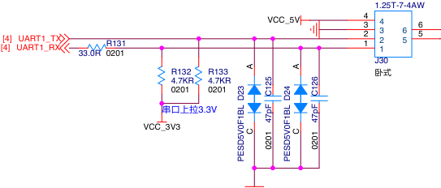

> 图中文字：
>
> 1.25T-7-4AW
> VCC_5V 43 4 6
> [4][4] UART1_RXUART1_TX 33.0R 0201R131 21 321 65 5
> J30
> R132 R133 卧式
> 4.7KR 4.7KR
> 0201 0201
> 串口上拉 3.3V
> VCC_3V3
> A A
> D23 C215 D24 C621
> pF pF
> 47 47
> C 0201 C 0201
> PESD5V0F1BL PESD5V0F1BL

**10**

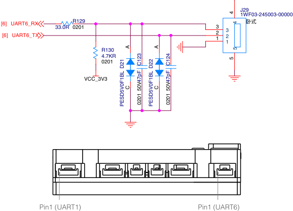

> 图中文字：
>
> J29
> 1WF03-245003-00000
> [6] UART6_RX 33.0R 0201R129 3 卧式
> [6] UART6_TX 21 32
> 1
> R130
> 4.7KR
> 0201
> VCC_3V3
> Pin1 (UART1) Pin1 (UART6)
> 4
> 4
> A A 5
> D21 C231 D22 C241 5
> pF pF
> 47 47
> C 50V C 50V
> PESD5V0F1BL 0201 PESD5V0F1BL 0201

## UART1 引脚线序：

## UART6 引脚线序：

|1|2|3|4 5V|1|2|3|
|---|---|---|---|---|---|---|
|RXD|TXD|GND||GND|TXD|RXD|

- 需要注意， UART6 接口线序与裁判系统电源模块一致，因此开发板与电源模块通信时需要 将线材的 TX 与 RX 线序交叉；

- 开发板的外壳丝印（ UART1 与 UART2 ）与 STM32 的实际串口配置并不对应，外壳丝印 UART1 对应 STM32 的 UART6 ，外壳丝印 UART2 对应 STM32 的 UART1 。

## CAN 总线接口

开发板集成 2 路 CAN 总线接口，其中 CAN1 总线接口为 2-pin 接口， CAN2 总线接口为 4-pin 接口。 CAN 总线接口最大支持 1M 传输速度，可用于控制 RoboMaster 电调或与其他设备通信，接口的原理 图及线序如下所示。

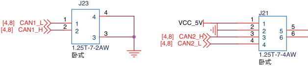

> 图中文字：
>
> J23
> 4 J21
> [4,8][4,8] CAN1_HCAN1_L 12 1.25T-7-2AW12 43 3 [4,8][4,8] CAN2_LVCC_5VCAN2_H 1234 1234 56 56
> 卧式 1.25T-7-4AW
> 卧式

**11**

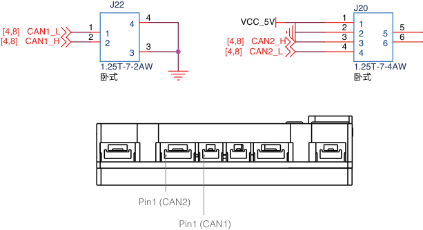

> 图中文字：
>
> J22 J20
> [4,8][4,8] CAN1_HCAN1_L 12 12 43 43 [4,8][4,8]VCC_5VCAN2_LCAN2_H 1234 1234 56 56
> 1.25T-7-2AW 1.25T-7-4AW
> 卧式 卧式
> Pin1 (CAN2)
> Pin1 (CAN1)

|CAN1引脚线序： 1 2 CANL CANH C|CAN1引脚线序： 1 2 CANL CANH C|AN2引脚线序：|AN2引脚线序：|AN2引脚线序：|AN2引脚线序：|
|---|---|---|---|---|---|
|1|2|1|2|3|4|
|CANL|CANH|5V|GND|CANH|CANL|

## PWM 接口

开发板集成 7 路 PWM 输出接口，用于连接 5V 舵机模块或其他 PWM 驱动模块， 7 路 PWM 接口总输 出电流最大可达 5A ，其原理图如下所示。

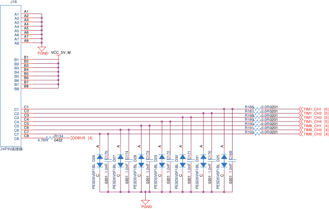

> 图中文字：
>
> J16
> A1A2A3A4A5A6A7A8 A1A2A3A4A5A6A7A8
> PGND VCC_5V_M
> B1B2B3B4B5B6B7B8 B1B2B3B4B5B6B7B8
> C1C2C3C4C5C6C7C8 C1C2C3C4C5C6C7C8 4.7KR 0402R134 DBUS [4] R1RRRRRR11111188889996789012 0.00.00.00.00.00.00.0RRRRRRR 0201020102010201020102010201 TIM1_CH1TIM1_CH2TIM1_CH3TIM1_CH4TIM8_CH1TIM8_CH2TIM8_CH3 [5][5][5][5][4][4][4]
> 24PIN连接器
> PGND
> A A A A A A A
> D26 C157 D27 C417 D28 C317 D29 C217 D30 C117 D31 C017 D25 C691
> nF nF nF nF nF nF nF
> 1.0 1.0 1.0 1.0 1.0 1.0 1.0
> C 0201 C 0201 C 0201 C 0201 C 0201 C 0201 C 0201
> PESD5V0F1BL PESD5V0F1BL PESD5V0F1BL PESD5V0F1BL PESD5V0F1BL PESD5V0F1BL PESD5V0F1BL

**12**

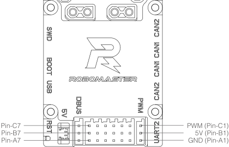

> 图中文字：
>
> Pin-C7 PWM (Pin-C1)
> Pin-B7 5V (Pin-B1)
> Pin-A7 GND (Pin-A1)

## DBUS 接口

开发板集成 1 路 DBUS 接口 , 与 PWM 接口共用一个连接器，其接口原理图如下所示。 DBUS 信号经 反相电路后连接到 STM32 的 UART3 ，波特率一般设置为 100kbps 。

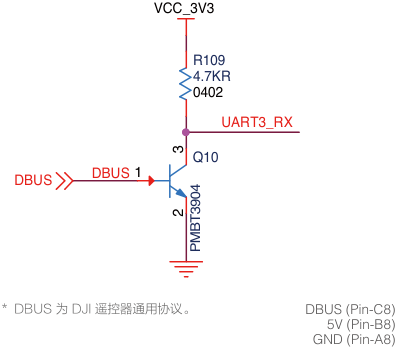

> 图中文字：
>
> VCC_3V3
> R109
> 4.7KR
> 0402
> UART3_RX
> Q10
> DBUS 1
> DBUS
> *  DBUS 为 DJI 遥控器通用协议。 DBUS (Pin-C8)
> 5V (Pin-B8)
> GND (Pin-A8)
> 3
> 2
> PMBT3904

## 数字摄像头FPC 接口

开发板集成 1 个支持 DCMI 的 FPC 接口（ 18-pin ），可连接 8 位 CMOS 照相机模块，并支持多种数据格式， 该接口的原理图如下所示。

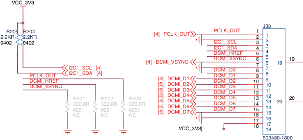

> 图中文字：
>
> VCC_3V3
> J33
> 2.2KRR205 2.2KRR204 [4] PCLK_OUT PCLK_OUT 12 1
> 0402 0402 I2C1_SCL 3 2
> I2C1_SDA 4 3
> DCMI_HREF 5 4
> DCMI_VSYNC 6 5 19
> [4] DCMI_VSYNC 7 6 19
> I2C1_SCL [4] DCMI_D0 8 7
> PCLK_OUTDCMI_HREFDCMI_VSYNC I2C1_SDA330.0R0201NCR201 [4]330.0R0201NCR202 330.0R0201NCR203 [4][5][5][5][4][5][5] DCMI_D1DCMI_D2DCMI_D3DCMI_D4DCMI_D5DCMI_D6DCMI_D7 DCMIDCMIDCMIDCMIDCMIDCMIDCMI_______D1D2D3D4D5D6D7 101112131415169 89101112131415 20 20
> 17 16
> VCC_3V3 18 1718
> 503480-1800

> 图中文字：
>
> Pin1

## 蜂鸣器

开发板集成一个贴片式无源蜂鸣器，需要使用 PWM 驱动，额定频率 4000Hz 。用户也可以通过调节不 同的 PWM 频率，改变蜂鸣器的输出音调。

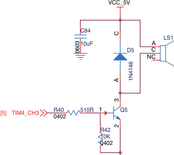

> 图中文字：
>
> VCC_5V
> C84
> LS1
> 10uF A
> D5 C
> NC
> [5] TIM4_CH3 R040240 510R 1 Q5
> R42
> 10K
> 0402
> C
> 6030
> A 1N4148
> 3
> 2

## 电压检测

开发板集成了 1 路电压检测，用于检测输入电压 VCC_BAT ，该电压分压后连接到 STM32 的 ADC （ PF10 ）； D10 起到箝压作用，用于保护 STM32 的 ADC 接口。

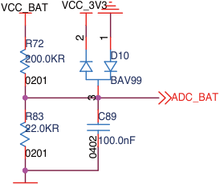

> 图中文字：
>
> VCC_BAT VCC_3V 3
> R72
> 200.0KR D10
> 0201 B AV99
> ADC_BAT
> R83 C89
> 22.0KR
> 100.0nF
> 0201
> 2 1
> 3
> 02
> 04

## 六轴惯性测量单元

开发板内部集成一个高性能的 6 轴惯性测量单元。惯性测量单元选用抗震性能卓越的 BMI088 ，配合 特殊的减震结构设计，可大幅提升冲击工况下陀螺仪的可靠性。为了改善惯性测量单元的温飘问题， 开发板增加了加热电路，用户可以通过 STM32 的 TIM10_CH1 （对应的 IO 为 PF6 ）实现对陀螺仪做 恒温处理。加热电路如下所示， Heat_Power 为 5V ，当 TIM10_CH1 保持高电平时，加热功率为 0.58W ， 加热温度一般控制在比电路板正常工作温度高 15~20 ℃为宜。

STM32 与 BMI088 的通信方式为 SPI 通信，支持最大 10MHz 的通信速率。原理图如下所示。

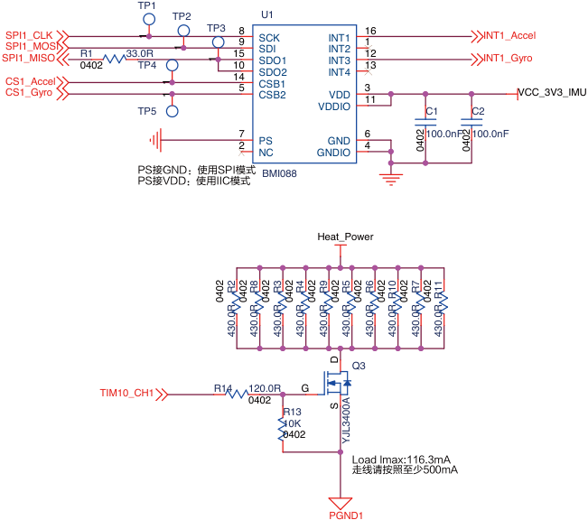

> 图中文字：
>
> TP1
> TP2 U1
> SPI1_MISOSPI1_CLKSPI1_MOSI R04021 33.TP40R TP3 115089 SCKSDISDO1 INT1INT2INT3 1111623 INT1_AccelINT1_Gyro
> CS1_AccelCS1_Gyro 145 SDO2CSB1CSB2 INT4VDD 311 V CC_3V3_IMU
> TP5 VDDIO C1 C2
> 7 6 100.0nF 100.0nF
> 2 PS GND 4
> NC GNDIO
> PS接GND：使用SPI模式 BMI088
> PS接VDD：使用IIC模式
> Heat_Power
> Q3
> TIM10_CH1 R14 120.0R G
> 0402
> R13
> 10K
> 0402
> Load Imax:116.3mA
> 走线请按照至少500mA
> PGND1
> 1
> 1
> 1
> 1
> 1
> 02 02
> 04 04
> 2 8 3 4 9 5 6 0 7 1
> R R R R R R R 1 R 1
> 0402 0402 0402 0402 0402 0402 0402 0402 R 0402 0402 R
> R R R R R R R R R R
> 0.0 0.0 0.0 0.0 0.0 0.0 0.0 0.0 0.0 0.0
> 43 43 43 43 43 43 43 43 43 43
> D
> S YJL3400A

## 磁力计

开发板集成了一个三轴磁力计芯片，即 IST8310 。 STM32 与 IST8310 的通信方式为 IIC 通信，支持最 大 400kHz 的通信速率。 IST8310 的默认 IIC 地址为 0x0E ，其原理图如下所示。

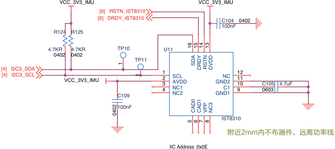

> 图中文字：
>
> VCC_3V3_IMU VCC_3V3_IMU
> [6] RSTN_IST8310
> [6] DRDY_IST8310 C104 0402
> 100nF
> R124 R125
> 4.7KR 4.7KR TP10 U11
> 0402 0402
> TP11
> [4][4] I2C3_SDAI2C3_SCL VCC_3V3_IMU 312 SCLAVDD GND2NC 121011 C105 4.7uF
> 4 NC1 C1 9 0603
> C109 NC2 GND1
> 100nF
> IST8310
> 附近2mm内不布器件，远离功率线
> IIC Address :0x0E
> 16 15 14 13
> 1 SDA DRDY RSTN DVDD
> 1
> 0204 CAD0 CAD1 VPP NC3
> 5 6 7 8

**16**

## 使  用

开发板支持 SWD 或 DFU 下载固件。用户可通过 J-link 或 ST-link 下载与调试程序（ SWD 模式）；也可 以通过 USB 下载程序到开发板（ DFU 模式）。用户可前往以下网址 https://www.robomaster.com/zhCN/products/components/general/development-board-type-c#downloads 下载出厂程序调试开发板。

## 特征参数

|输入电压|8 V~28 V|
|---|---|
|待机电流 重量 尺寸（长× 宽x高）|0.01 A @DC 24 V 38 g 60×41×16.3 mm|
|工作温度范围|0~55℃|

## 附表

## 附单板网络名与 IO 对照表。

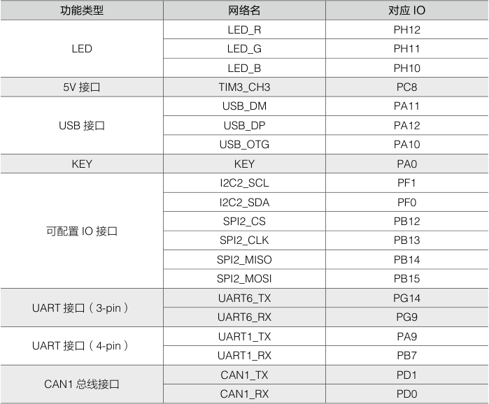

> 图中文字：
>
> 功能类型 网络名 对应IO
> LED_R PH12
> LED LED_G PH11
> LED_B PH10
> 5V  接口 TIM3_CH3 PC8
> USB_DM PA11
> USB  接口 USB_DP PA12
> USB_OTG PA10
> KEY KEY PA0
> I2C2_SCL PF1
> I2C2_SDA PF0
> SPI2_CS PB12
> 可配置 IO  接口
> SPI2_CLK PB13
> SPI2_MISO PB14
> SPI2_MOSI PB15
> UART6_TX PG14
> UART  接口（ 3-pin ）
> UART6_RX PG9
> UART1_TX PA9
> UART  接口（ 4-pin ）
> UART1_RX PB7
> CAN1_TX PD1
> CAN1  总线接口
> CAN1_RX PD0

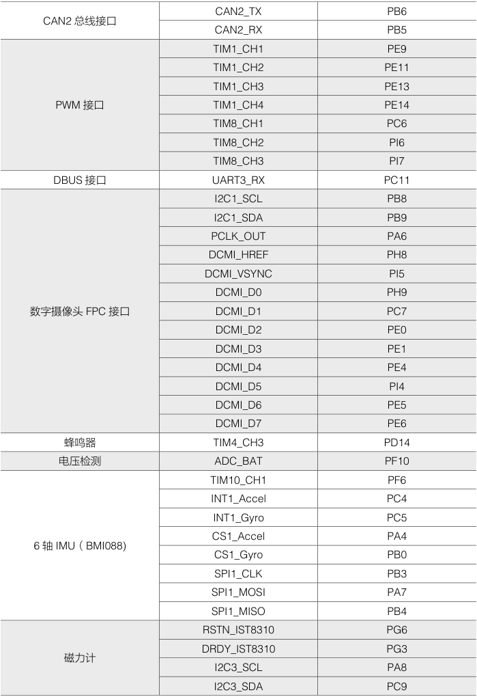

> 图中文字：
>
> CAN2_TX PB6
> CAN2  总线接口
> CAN2_RX PB5
> TIM1_CH1 PE9
> TIM1_CH2 PE11
> TIM1_CH3 PE13
> PWM  接口 TIM1_CH4 PE14
> TIM8_CH1 PC6
> TIM8_CH2 PI6
> TIM8_CH3 PI7
> DBUS  接口 UART3_RX PC11
> I2C1_SCL PB8
> I2C1_SDA PB9
> PCLK_OUT PA6
> DCMI_HREF PH8
> DCMI_VSYNC PI5
> DCMI_D0 PH9
> 数字摄像头 FPC  接口 DCMI_D1 PC7
> DCMI_D2 PE0
> DCMI_D3 PE1
> DCMI_D4 PE4
> DCMI_D5 PI4
> DCMI_D6 PE5
> DCMI_D7 PE6
> 蜂鸣器 TIM4_CH3 PD14
> 电压检测 ADC_BAT PF10
> TIM10_CH1 PF6
> INT1_Accel PC4
> INT1_Gyro PC5
> CS1_Accel PA4
> 6  轴 IMU （ BMI088)
> CS1_Gyro PB0
> SPI1_CLK PB3
> SPI1_MOSI PA7
> SPI1_MISO PB4
> RSTN_IST8310 PG6
> DRDY_IST8310 PG3
> 磁力计
> I2C3_SCL PA8
> I2C3_SDA PC9

WWW.ROBOMASTER.COM Copyright © 2020 大疆创新 版权所有

中国印制
