## DAMIAO | 达妙科技

## DM-MC-Board02 电机开发板

使用说明书 V1.1

2025.07.23

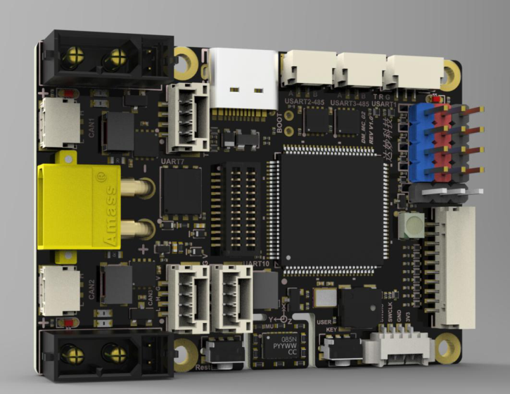

|日期|版本|变更内容|
|---|---|---|
|2024.02.06|V1.0|初版创建|
|2025.07.23|V1.1|修订电源树引脚标识，更新管脚配置图|

## 目 录

|章节|页码|
|---|---|
|免责声明|1|
|注意事项|1|
|开发板简介|1|
|特征参数|2|
|功能说明|3|
|1、电源树|3|
|2、STM32H723VGT6 最小系统|3|
|3、CAN 接口|4|
|4、RS485 接口|5|
|5、USB 接口|5|
|6、SBUS 接口|6|
|7、PWM 接口|6|
|8、串口|6|
|9、SWD（Serial Wire Debug）接口|7|
|10、板载指示灯|8|
|11、蜂鸣器|8|
|12、按键|8|
|13、板载 IMU|8|
|14、LCD 扩展接口|9|
|15、QSPI Flash|10|
|16、摄像头接口|10|
|17、用户扩展 IO|11|
|18、电源电压|12|
|19、可控电源接口|12|
|附录一 管脚配置图|15|

## 免责声明

感谢您购买达妙科技 DAMIAO DM-MC-Board02 电机开发板（以下简称“开发板”）。在使用本产品之前，请仔细阅读并遵循本文及达妙科技提供的所有安全指引，否则可能会给您和周围的人带来伤害，损坏本产品或其他周围物品。一旦使用本产品，即视为您已经仔细阅读本文档，理解、认可和接受本文档及本产品所有相关文档的全部条款和内容。您承诺仅出于正当目的使用本产品。您承诺对使用本产品以及可能带来的后果负全部责任。达妙科技对于直接或间接使用本产品而造成的损坏、伤害以及任何法律责任不予负责。

DAMIAO 是深圳市达妙科技有限公司的商标。本文出现的产品名称、品牌等，均为其所属公司的商标。本产品及手册为深圳市达妙科技有限公司版权所有。未经许可，不得以任何形式复制翻印。本文档及本产品所有相关的文档最终解释权归深圳市达妙科技有限公司所有。如有更新，恕不另行通知。

## 注意事项

1. 请按照说明书将连接线正确连接后再使用，避免造成接口以及开发板损坏。

2. 请按照说明书建议的电压、电流、温度等工作环境使用，以免损坏开发板，影响产品的使用寿命。

3. 使用前请检查各零部件是否完好。如有部件缺失、老化、损坏等，请停止使用。

4. 使用时做好防护，不要用手直接接触开发板上的元器件，防止静电、物理损坏等；保持开发板干净清洁，避免异物等导致的短路或性能降低。

5. 开发板上电或使用过程中，出现打火、冒烟、烧焦味等异常情况时，请立即关掉电源。

## 开发板简介

DM-MC-Board02 主控芯片是 STM32H723VGT6，该开发板是一款面向机器人控制的主控，具备防反接和缓启动等多重防护。并集成了高性能 IMU（BMI088）以及 1.69 寸 240*280 分辨率的 LCD 模块。该主控具备三个 CANFD 接口、两个高速 RS485 接口、一个 USB 接口、以及 SBUS、PWM 等丰富接口。可以配合达妙科技出品的关节电机、直驱电机等产品制作 AGV 轮式机器人、平衡车、足式机器人、轮足等 DIY 产品。

## 特征参数

|类别|项目|参数|备注|
|---|---|---|---|
|结构参数|供电电压|12~24V|支持 6S 供电|
||可控电源|每路持续 5A||
||板载电源|5V@2A|对外|
||重量|19.5g||
||尺寸|56x40mm||
|技术参数|MCU|STM32H723VGT6|Arm Cortex-M7 MCU|
||可控电源|x2|PMOS（XT30 2+2）|
||CANFD|x3|最大 5Mbps|
||RS485|x2|最大 10Mbps|
||USB|x1||
||SBUS|x1||
||PWM|x4||
||串口|x3||
||SWD|x1||
||W2812 彩灯|x1||
||蜂鸣器|x1||
||按键|x2||
||IMU|x1|BMI088|
||LCD 扩展口|x1|SPI+IIC|
||QSPI Flash|8Mb|W25Q64JV|
||DCMI 接口|x1|24Pin 无需转接|
||扩展接口|x1|2 串口 1 SPI 1 IIC|

## 功能说明

### 1、电源树

开发板支持 12~24V(支持 6S)输入，电源输入通过防反接电路和缓启动电路给系统供电。一路可控 DCDC 5V 输出，用于给 4 路 PWM、一路串口和一路 CAN 接口供电，该路电源可以提供 2A 电流持续输出。另一路 DCDC 降压至 5V 用于给系统供电。另外具备两路可控输出接口，每路使用单独管脚控制开关，这两路可控电源每路均可提供 5A 电流输出能力。

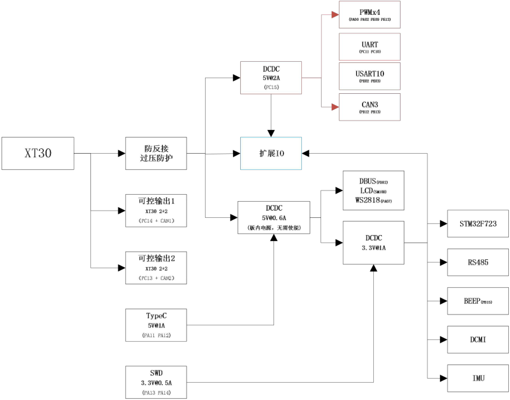

### 2、STM32H723VGT6 最小系统

该开发板采用 STM32H723VGT6 芯片，带 DSP 和 FPU 的高性能系列 ARM Cortex-M7 的 MCU，具有 1MByte Flash、564 Kbytes、550 MHz CPU、ART 加速器。开发板晶振采用 24Mh 无源晶振，并通过 MCO1（PA8）给外接摄像头模块提供 24Mhz 时钟。

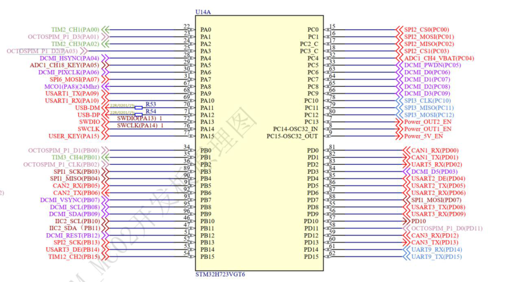

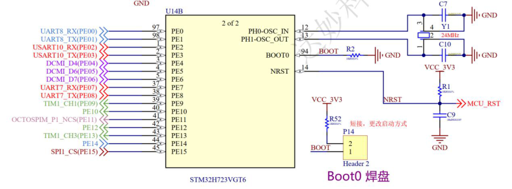

### 3、CAN 接口

在机器人控制中，大部分执行机构使用 CAN 接口，本开发板考虑到用户对 CAN 总线（CANFD）需求，引出 3 路 CAN 信号，方便客户扩展更多的设备。

*注：使用 CAN 总线需要 USB 供电或者 24V 电源供电（CAN 芯片采用 5V 供电）。*

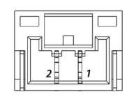

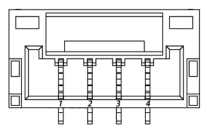

|接口引脚|引脚信号|单片机引脚|类型|
|---|---|---|---|
|1|CAN_L|--|信号|
|2|CAN_H|--|信号|

|接口引脚|引脚信号|单片机引脚|类型|
|---|---|---|---|
|1|VCC|--|电源|
|2|GND|--|电源|
|3|CAN_H|--|信号|
|4|CAN_L|--|信号|

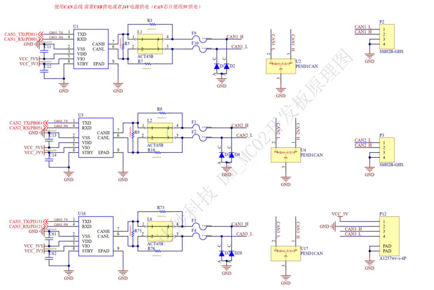

### 4、RS485 接口

该开发板配备了两路高速 RS485 接口，转换芯片支持最大 10Mbps 速率。两路 485 接口分别以 SM02B-GHS 的接口引出。

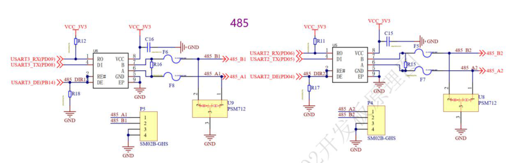

### 5、USB 接口

开发板配备一个 USB 全速接口，方便用户与 PC 通讯。

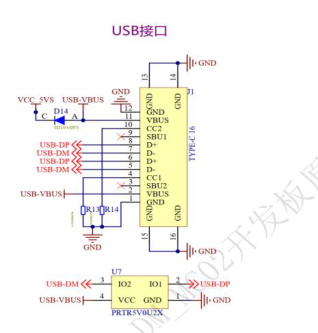

### 6、SBUS 接口

为方便客户使用遥控器，该开发板集成一个 SBUS 接收机接口。SBUS 总线使用的是 TTL 电平的反向电平，即标准 TTL 中的 1 取反为 0，而 0 则取反为 1，串口波特率为 100000，数据位为 8 位，2 个停止位，偶校验。

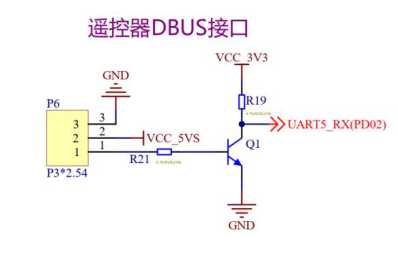

|接口引脚|引脚信号|单片机引脚|IO 类型|
|---|---|---|---|
|1|S|PC02|反相 GPIO|
|2|5V|--|电源|
|3|GND|--|地|

### 7、PWM 接口

为方便用户使用 PWM 驱动舵机等执行器，开发板上引出了 4 路 PWM，并为这 4 路 PWM 一起提供高达 5V@2A 驱动能力的电源（该电源为可控，需使能输出后使用）。用户也可以根据场景需求，将 GPIO 复用成其他功能使用。

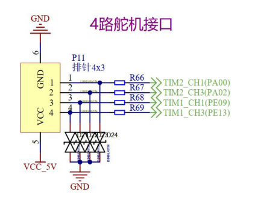

### 8、串口

该开发板提供两路串口供客户使用，其中一路提供 5V 电源供电能力，可以外接一些传感器模块（IMU 等）使用。

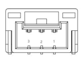

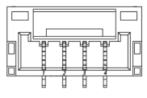

|接口引脚|引脚信号|单片机引脚|类型|
|---|---|---|---|
|1|GND|--|电源|
|2|USART1_TX|PA09|信号|
|3|USART1_RX|PA10|信号|

|接口引脚|引脚信号|单片机引脚|类型|
|---|---|---|---|
|1|GND|--|电源|
|2|UART7_TX|PE08|信号|
|3|UART7_RX|PE07|信号|

|接口引脚|引脚信号|单片机引脚|类型|
|---|---|---|---|
|1|GND|--|电源|
|2|UART10_TX|PE03|信号|
|3|UART10_RX|PE02|信号|

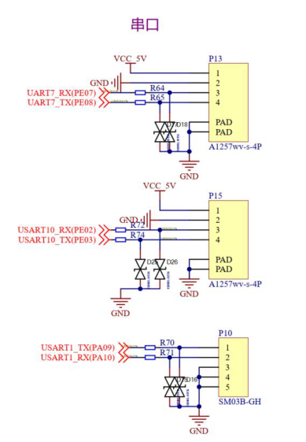

### 9、SWD（Serial Wire Debug）接口

调试接口选用 SWD（Serial Wire Debug）接口，可以使用 J-link、STLink 等调试工具下载仿真。

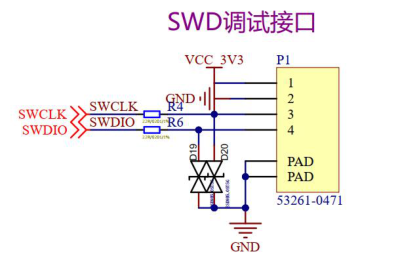

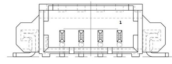

|接口引脚|引脚信号|单片机引脚|IO 类型|
|---|---|---|---|
|1|VCC|--|3.3V|
|2|GND|--|地|
|3|SWCLK|PA14|5V 容忍|
|4|SWDIO|PA13|5V 容忍|

### 10、板载指示灯

为了方便客户显示各种运行状态板载指示灯升级成 2812 彩灯，一个 WS2812 灯珠有红绿蓝三种颜色，分别控制这三种颜色的亮度可配出各种颜色。彩灯信号输入连接到一个 SPI 的 MOSI 管脚上，方便用户控制。

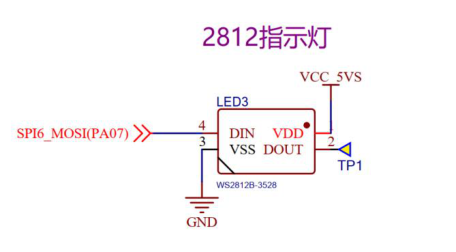

### 11、蜂鸣器

该开发板板载一颗无源蜂鸣器，其典型发声频率 4000HZ。

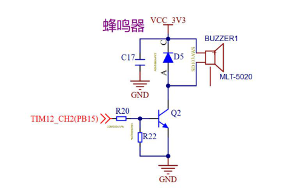

### 12、按键

该开发板有一个复位按键和一个用户按键。

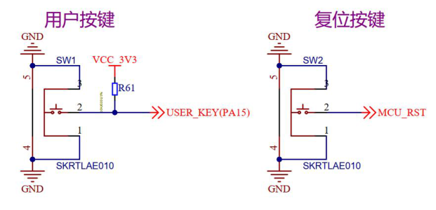

### 13、板载 IMU

BMI088 是一款高性能六轴惯性测量单元（IMU），具有高振动稳定性，专为无人机和机器人应用而设计。BMI088 专门设计用于有效抑制由于 PCB 上的共振或整个系统的结构而可能发生的振动。除了高振动稳健性外，BMI088 卓越的温度稳定性有助于提高估算滤波器性能，IMU 具有极宽的 24G 加速度计范围。该开发板采用 SPI 总线与 BMI088 通讯，并带有加热电阻，结合 BMI088 内部的温度传感器可以轻松实现恒温操作。

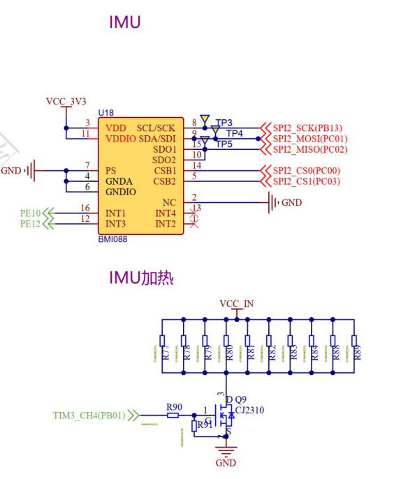

### 14、LCD 扩展接口

为方便客户更好地与开发板交互，该开发板配备了一个 1.69 寸 240*280 的彩色屏幕以及一个多功能按键。该模块采用连接器扩展的的方式接入，用户也可以根据需求接入自己的 DIY 模块。

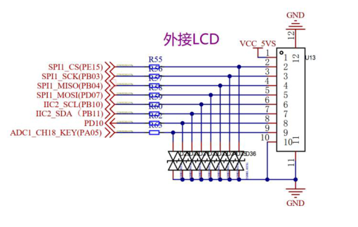

|接口引脚|引脚信号|单片机引脚|类型|
|---|---|---|---|
|1|5V|--|电源|
|2|GND|--|电源|
|3|SPI1_CS|PE15|信号|
|4|SPI1_SCK|PB03|信号|
|5|SPI1 MISO|PB04|信号|
|6|SPI1 MOSI|PD07|信号|
|7|IIC2_SCL|PB10|信号|
|8|IIC2_SDA|PB11|信号|
|9|GPIO|PD10|信号|
|10|KEY|PA05|信号|

### 15、QSPI Flash

为方便用户存储数据，开发板上集成了一颗 8Mbytes 的 QSPI Flash 芯片，用户可以存储调试数据或者 LCD 显示图片等。

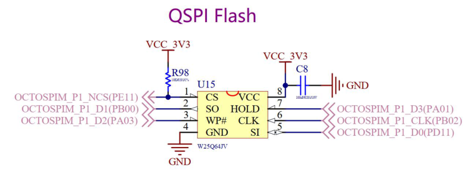

### 16、摄像头接口

MCU 内置 DCMI 接口，可以外接 8~14bit 的 CMOS 摄像头。本开发板直接引出一组 DCMI 接口，并板载了摄像头所需的 2.8V、1.5V 电源，可直接对接摄像头模组，无需转换。推荐模组 OV5640，其他模组请注意线序。

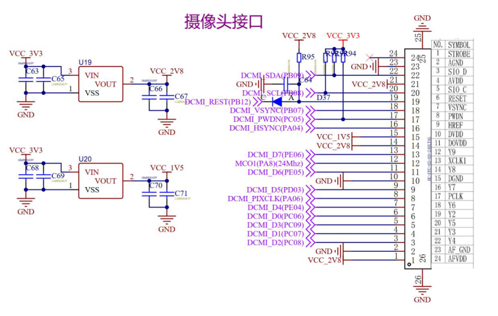

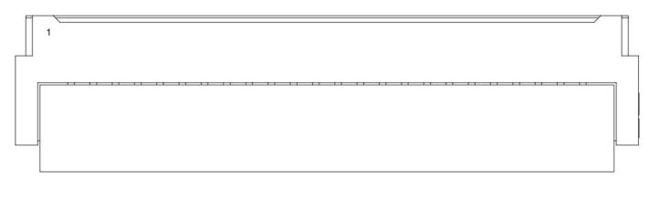

|接口引脚|引脚信号|单片机引脚|IO 类型|
|---|---|---|---|
|1|VCC_2V8|--|电源|
|2|GND|--|电源|
|3|DCMI D2|PC08|GPIO|
|4|DCMI D1|PC07|GPIO|
|5|DCMI D3|PC09|GPIO|
|6|DCMI D0|PC06|GPIO|
|7|DCMI D4|PE04|GPIO|
|8|DCMI PIXCLK|PA06|GPIO|
|9|DCMI D5|PD03|GPIO|
|10|GND|--|电源|
|11|DCMI D6|PE05|GPIO|
|12|MCO1 24Mhz|PA08|GPIO|
|13|DCMI D7|PE06|GPIO|
|14|VCC_2V8|--|电源|
|15|VCC_1V5|--|电源|
|16|DCMI HSYNC|PA04|GPIO|
|17|DCMI PWDN|PC05|GPIO|
|18|DVCMI VSYNC|PB07|GPIO|
|19|DVCMI REST|PB12|GPIO|
|20|DCMI SCL|PB08|GPIO|
|21|VCC_2V8|--|电源|
|22|DCMI SDA|PB09|GPIO|
|23|GND|PC10|GPIO|
|24|NC|NC|NC|

### 17、用户扩展 IO

受限于版面尺寸的限制，该开发板不能引出太多接口，考虑到用户对 IO 的需求，该开发板引出一个 24Pin 的扩展 IO，这个接口上预留了输入电源、5V 可控电源、3.3V 电源，以及一路 SPI 接口、一路 IIC 接口（与 DCMI 共用）、两路串口、一路 CAN 信号、两路 485 信号。用户可以根据自己的需求制作扩展板使用。我们会提供一个扩展板的工程文件，供客户参考。

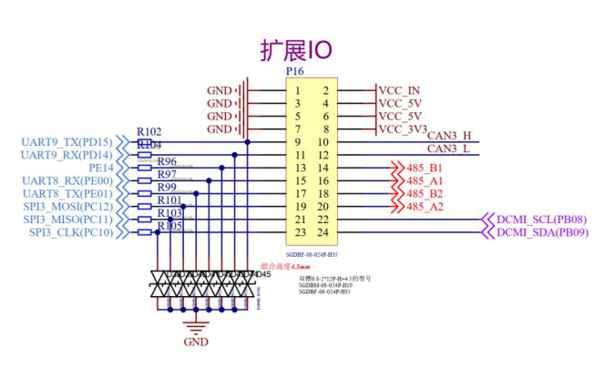

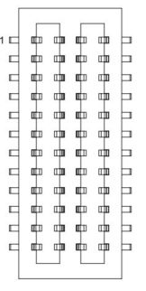

|接口引脚|引脚信号|单片机引脚|IO 类型|
|---|---|---|---|
|1|GND|--|电源|
|2|VCC_IN|--|电源|
|3|GND|--|电源|
|4|VCC_5V|--|电源|
|5|GND|--|电源|
|6|VCC_5V|--|电源|
|7|GND|--|电源|
|8|VCC_3V3|--|电源|
|9|UART9_TX|PD15|GPIO|
|10|CAN3_H|||
|11|UART9_RX|PD14|GPIO|
|12|CAN3_L|||
|13|GPIO|PE14|GPIO|
|14|485_B1|||
|15|UART8_RX|PE00|GPIO|
|16|485_A1|||
|17|UART8_TX|PE01|GPIO|
|18|485_B2|||
|19|SPI3_MOSI|PC12|GPIO|
|20|485_A2|||
|21|SPI3_MISO|PC11|GPIO|
|22|IIC_SCL|PB08|GPIO|
|23|SPI3_CLK|PC10|GPIO|
|24|IIC_SDA|PB09|GPIO|

### 18、电源电压

为方便用户监测电源供电电压，该开发板具备一个简单的电压采集电路。

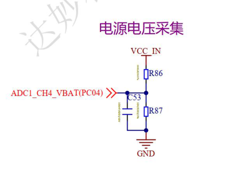

### 19、可控电源接口

电机接口采用 XT30(2+2)PW-M 端子，其中供电部分采用 PMOS 控制上电断电。

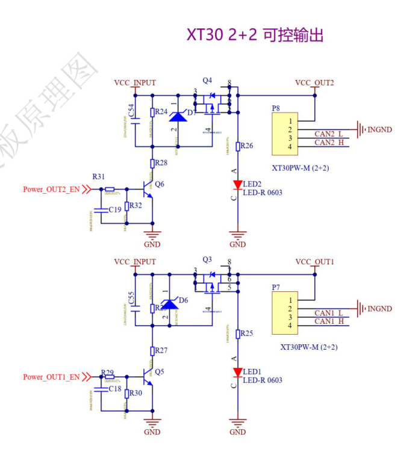

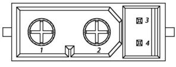

|接口引脚|引脚信号|单片机引脚|类型|
|---|---|---|---|
|1|VCC|--|电源|
|2|GND|--|电源|
|3|CAN_L|--|信号|
|4|CAN_H|--|信号|

对外 5V 供电

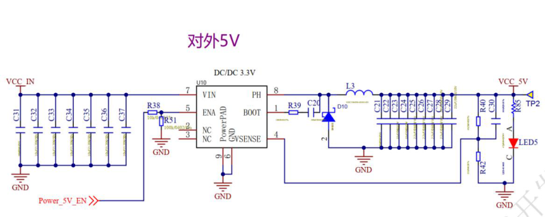

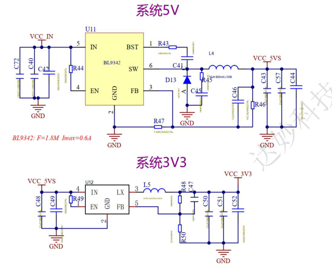

## 附录一 管脚配置图

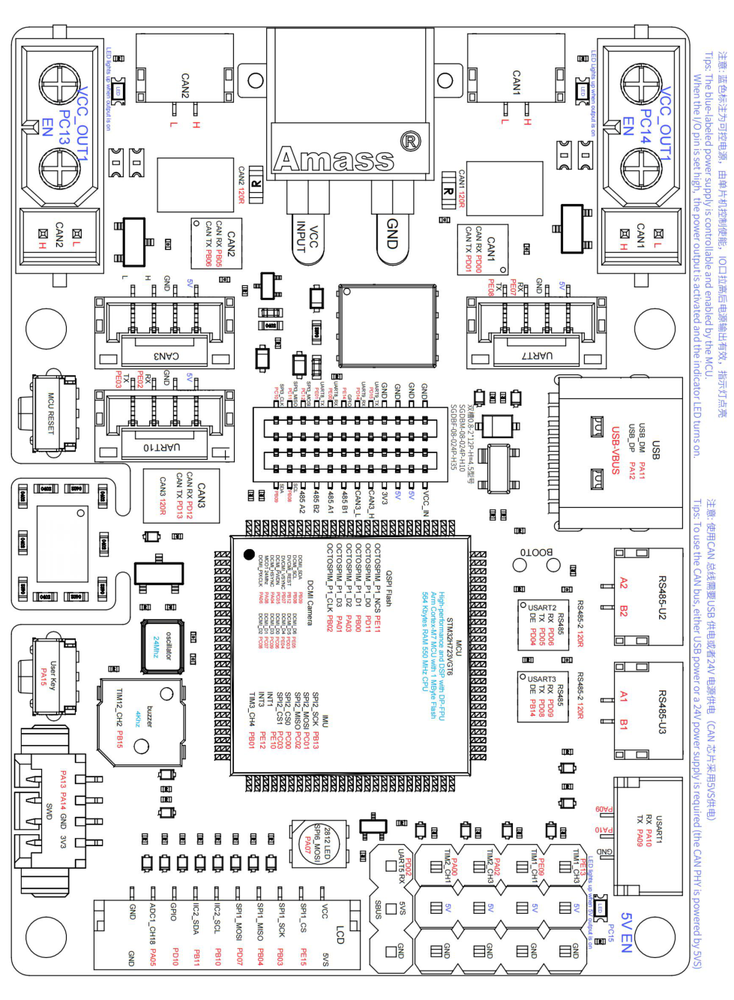
